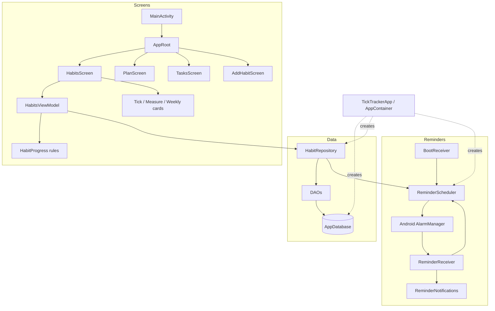

# File guide

What every file in the project is for, and where it sits in the app's flow. Read [flow_state.md](flow_state.md) first for the flow itself; decision numbers such as (D16) refer to [decisions.md](decisions.md).

**Keep this file current.** When a file is added, removed or changes its job, update its entry here.

The Habits section is built: the wizard, the cards, logging and streaks. Plan and Tasks are still placeholders. Each entry is marked:

- **Working**: does its job.
- **Untested on a phone**: written and compiles, but has not been run on a device yet.
- **Placeholder**: exists so the structure is in place; the real thing is still to be built.

## How the pieces connect

The app has three layers, and each only talks to the one below it:

1. **Screens** (`ui/`) show data and pass on taps. A screen talks to its view model.
2. **Data** (`data/`) stores everything. View models talk to `HabitRepository`, which is the only thing that touches the database.
3. **Reminders** (`reminders/`) deal with Android's alarm scheduler. The repository tells the scheduler when reminders change; Android calls the receivers when one is due.

`TickTrackerApp` creates the shared objects once, in `AppContainer`, and everything else borrows them from there.

## Where each step of the flow lives

The steps are the ones in [flow_state.md section 1](flow_state.md#1-the-whole-flow-at-a-glance).

| Step in the flow | Files involved |
| --- | --- |
| App opens on the Habits section | `TickTrackerApp.kt` → `MainActivity.kt` → `ui/AppRoot.kt` → `ui/habits/HabitsScreen.kt` |
| Habit cards or the empty state are shown | `HabitsScreen.kt` picks `cards/TickCard.kt`, `cards/MeasureCard.kt` or `cards/WeeklyCard.kt` ← `HabitsViewModel.kt` ← `HabitRepository` ← the DAOs |
| + opens the add habit wizard | `AppRoot.kt` (floating button) → `ui/habits/add/AddHabitScreen.kt` |
| User moves through the four steps | `add/AddHabitScreen.kt` (frame) shows a step from `add/AddHabitSteps.kt`; choices are held in `add/AddHabitViewModel.kt` |
| Habit is saved | `AddHabitViewModel.save()` → `HabitRepository.createHabit()` → `HabitDao`, `CategoryDao`, `ReminderDao` |
| Reminders are registered with Android | `HabitRepository.createHabit()` → `ReminderScheduler.schedule()` |
| Today's entry is logged | Card button → `HabitsViewModel.onTick()` / `onSkip()` / `onResist()` / `onSlip()` / `onSetAmount()` / `onReset()` → `HabitRepository.setTodayState()` / `setTodayCount()` / `setTodayAmount()` / `clearToday()` → `HabitEntryDao` |
| Card, grid and progress update | The database change flows back by itself: `HabitEntryDao.observeAll()` → `HabitsViewModel.uiState` → the cards redraw |
| Reminder fires | Android → `ReminderReceiver.kt` → `ReminderNotifications.show()` → `ReminderScheduler.schedule()` for tomorrow |
| Notification is tapped | `ReminderNotifications.kt` builds the intent → `MainActivity.kt` |
| Phone restarts | Android → `BootReceiver.kt` → `ReminderScheduler.rescheduleAll()` |
| Midnight: day locks | `util/Dates.kt` `todayFlow()` emits the new date just after midnight, so open cards roll over. Nothing has to lock the old day: the repository only ever writes to today (D16, D19) |
| Streaks | `domain/HabitProgress.kt` `streak()`, called by `HabitsViewModel` each time the data or the day changes |

## Project root

| File | What it does |
| --- | --- |
| `README.md` | Introduces the app and links to these docs. |
| `.gitignore` | Keeps build output, the SDK path and signing keys out of git. |
| `settings.gradle.kts` | Names the project, lists where libraries are downloaded from, and includes the `app` module. |
| `build.gradle.kts` | Declares the build plugins (Android, Compose compiler, KSP) once, for modules to apply. |
| `gradle.properties` | Build settings: memory for the build, build cache on. |
| `gradle/libs.versions.toml` | The single list of library and plugin versions. Change a version here, nowhere else. |
| `gradlew`, `gradlew.bat`, `gradle/wrapper/` | The Gradle wrapper: downloads the right Gradle version and runs the build. `gradlew.bat` is for Windows. |
| `local.properties` | Where the Android SDK is on this machine. Not committed. |

## `app/`

| File | What it does |
| --- | --- |
| `app/build.gradle.kts` | Build settings for the app: package name `com.ticktracker`, SDK levels (minimum 26, target 36, compiled against 37), version, and the libraries it uses. |
| `app/src/main/AndroidManifest.xml` | Tells Android what the app contains: its permissions (notifications, exact alarms, start on boot), the one activity, and the two reminder receivers. |

## `app/src/main/kotlin/com/ticktracker/`

### App entry

| File | Status | What it does |
| --- | --- | --- |
| `TickTrackerApp.kt` | Untested on a phone | First code to run. Builds `AppContainer` (the database, the reminder scheduler and the repository), creates the notification channel, and adds the built-in categories. Also runs when Android wakes the app for a reminder, which is why receivers can reach the database. |
| `MainActivity.kt` | Untested on a phone | The only activity. Applies the theme and shows `AppRoot`. |

### `data/model/`

| File | Status | What it does |
| --- | --- | --- |
| `HabitEnums.kt` | Working | The fixed choices from the habit model: `HabitKind` (Tick, Measurable), `HabitDirection` (Build, Quit), `RepeatGoal`, `GoalPeriod`, and `EntryState` (Done, Skipped, Resisted, Slipped). (D05, D07) |

### `data/db/`

| File | Status | What it does |
| --- | --- | --- |
| `Entities.kt` | Untested on a phone | The database tables. `HabitEntity` is a habit. `HabitEntryEntity` is what was logged for one habit on one day, at most one row per day (D17). `CategoryEntity` and `HabitCategoryCrossRef` give a habit several categories (D09). `ReminderEntity` is one daily reminder time for a habit (D10). |
| `Daos.kt` | Untested on a phone | The database queries, one interface per table: `HabitDao`, `HabitEntryDao`, `CategoryDao`, `ReminderDao`. |
| `AppDatabase.kt` | Untested on a phone | Ties the tables and queries into one Room database file, `ticktracker.db`. `Converters` stores dates as day numbers. |

### `data/repository/`

| File | Status | What it does |
| --- | --- | --- |
| `HabitRepository.kt` | Untested on a phone | The only way screens read or change habit data. Creates and deletes habits, and logs today's entry. Its logging functions take no date, so they can only ever write to today; that is how the today-only rule is enforced (D16). Tells `ReminderScheduler` when reminders are added or removed. |

### `domain/`

| File | Status | What it does |
| --- | --- | --- |
| `HabitProgress.kt` | Working, unit tested | The tracking rules: whether a day or a week counts for a habit, the streak in days or weeks, and the week's progress text. No Android code. (D13, D26) |

### `reminders/`

| File | Status | What it does |
| --- | --- | --- |
| `ReminderTime.kt` | Working, unit tested | `nextOccurrence()`: works out when a daily reminder should next fire, today or tomorrow. |
| `ReminderScheduler.kt` | Untested on a phone | Registers and cancels alarms with Android's `AlarmManager`, and re-registers all of them after a restart. (D20) |
| `ReminderReceiver.kt` | Untested on a phone | Android runs this when a reminder is due, with the app open or closed. Shows the notification, then schedules the same reminder for tomorrow. |
| `BootReceiver.kt` | Untested on a phone | Android runs this after a restart or a clock or time zone change. Re-registers every reminder, because Android forgets alarms on restart. |
| `ReminderNotifications.kt` | Untested on a phone | Creates the "Reminders" notification channel and builds the notification. It has no timeout, so it stays until dismissed or opened (D22). |

### `ui/`

| File | Status | What it does |
| --- | --- | --- |
| `AppRoot.kt` | Untested on a phone | The app shell: the header with today's date and the settings button, the floating bottom bar with Habits, Plan and Tasks, and the + button. Owns navigation between screens. The settings button, and + on Plan and Tasks, do nothing yet. |
| `Placeholder.kt` | Working | `PlaceholderMessage`: a centred title and message, used for empty states and unbuilt screens. |
| `theme/Theme.kt` | Working | The colours (dark background, green accent) and `TickTrackerTheme`. |
| `habits/HabitsScreen.kt` | Untested on a phone | The Habits section: the Measure, Tick and Weekly tabs, the category filter chips, and the list of cards for the current tab, or an empty state. Also holds the dialog for typing a measurable amount and the delete confirmation. |
| `habits/HabitsViewModel.kt` | Untested on a phone | Builds what each card shows (`HabitCardState`: the habit, its entries, today, its streak, its categories) and carries out the logging actions: tick, skip, resisted, slipped, set amount, reset, delete. Decides what a tap means, such as undoing a tick that is already done (D26). |
| `habits/cards/CardParts.kt` | Untested on a phone | Pieces shared by all cards: the card frame, the header (icon, name, streak, buttons, overflow menu with Delete), the square action button, and `dayCellColor()`, which picks the colour of a day in a history grid. |
| `habits/cards/TickCard.kt` | Untested on a phone | A Tick habit's card: its buttons (tick; count such as 1/2; skip and tick; slipped and resisted) and the 20-week heatmap. (D12) |
| `habits/cards/MeasureCard.kt` | Untested on a phone | A Measurable habit's card: today's amount against the target, the reset and + buttons, and the 7-week grid of values with a Total row. (D12, D15, D17) |
| `habits/cards/WeeklyCard.kt` | Untested on a phone | Any habit on the Weekly tab: the current week as seven cells, with the week's progress. Display only. |
| `habits/HabitVisuals.kt` | Untested on a phone | The icons and colours a habit can use (`HabitIcons`, `HabitColors`), and `HabitBadge`, which draws a habit's icon on a circle of its colour. Used by the wizard and the habit list. |
| `habits/add/AddHabitScreen.kt` | Untested on a phone | The wizard's frame (D06): close or back button, the four-segment progress bar, the current step, and the Continue / Save Habit button. |
| `habits/add/AddHabitSteps.kt` | Untested on a phone | The four steps: kind (Tick with Build or Quit, or Measurable); name, icon and colour; tracking (repeat goal or unit, goal and target) and categories; reminder times. Asks for the notification permission when reminders are switched on. |
| `habits/add/AddHabitViewModel.kt` | Untested on a phone | Holds everything chosen in the wizard (`AddHabitState`), decides whether a step is complete, and turns the choices into a saved habit. |
| `habits/add/WizardComponents.kt` | Untested on a phone | Building blocks for the wizard: the progress bar, selectable chips, the − / + count stepper (D08), and the scrolling wheel used for the reminder time. |
| `plan/PlanScreen.kt` | Placeholder | Where the day timeline will go. |
| `tasks/TasksScreen.kt` | Placeholder | Where the task lists will go. |

### `util/`

| File | Status | What it does |
| --- | --- | --- |
| `Dates.kt` | Working | `today()`: the current day, midnight to midnight (D19). `todayFlow()`: the current day, updated just after each midnight. `headerDate()`: the header text, such as "Today, 14th Nov". |
| `Numbers.kt` | Working | `formatAmount()`: shows 5.0 as "5". `cleanDecimalInput()`: keeps typed amounts to plain numbers. |

## `app/src/main/res/`

| File | What it does |
| --- | --- |
| `values/strings.xml` | The app name and the notification channel's name and description. |
| `values/colors.xml` | The two colours needed outside Compose: the window background and the icon's green. |
| `values/themes.xml` | The window theme shown for the instant before the app draws. The real theme is `ui/theme/Theme.kt`. |
| `drawable/ic_launcher_foreground.xml` | The tick drawn on the app icon. |
| `drawable/ic_notification.xml` | The small tick shown in the status bar for a reminder. |
| `mipmap-anydpi-v26/ic_launcher.xml` | The app icon: the tick on a green background. |

## `app/src/test/`

| File | What it does |
| --- | --- |
| `kotlin/com/ticktracker/reminders/ReminderTimeTest.kt` | Checks `nextOccurrence()`: a reminder fires today if its time is ahead, tomorrow if it has passed or is exactly now. |
| `kotlin/com/ticktracker/domain/HabitProgressTest.kt` | Checks the tracking rules: weeks start on Monday, daily and weekly streaks, an unfinished today not breaking a streak, skips, and what counts as a met day for each kind of habit. |

## Not built yet

Things the flow needs that have no file yet:

- The exact alarm and battery optimisation checks (D20)
- Opening the right habit when a reminder is tapped
- Habit settings: editing a habit and its reminders after creation
- Settings screen
- Everything for Plan and Tasks, including their tables and reminders
