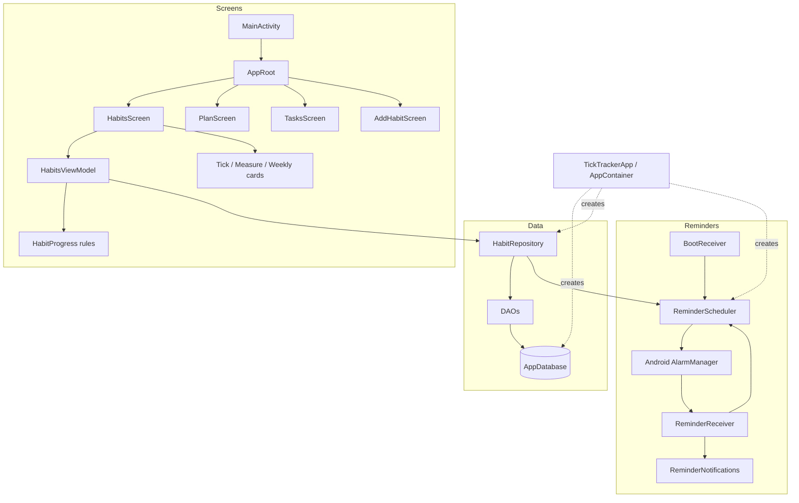

# File guide

What every file in the project is for, and where it sits in the app's flow. Read [flow_state.md](flow_state.md) first for the flow itself; decision numbers such as (D16) refer to [decisions.md](decisions.md).

**Keep this file current.** When a file is added, removed or changes its job, update its entry here.

Every section is built: Habits, Tasks, Plan and Settings. Each entry is marked:

- **Working**: does its job.
- **Works on the phone**: confirmed working by the owner on their phone.
- **Untested on a phone**: written and compiles, but has not been confirmed on a device yet.
- **Placeholder**: exists so the structure is in place; the real thing is still to be built.

## How the pieces connect

The app has three layers, and each only talks to the one below it:

1. **Screens** (`ui/`) show data and pass on taps. A screen talks to its view model.
2. **Data** (`data/`) stores everything. View models talk to `HabitRepository`, which is the only thing that touches the database.
3. **Reminders** (`reminders/`) deal with Android's alarm scheduler. The repository tells the scheduler when reminders change; Android calls the receivers when one is due.

`TickTrackerApp` creates the shared objects once, in `AppContainer`, and everything else borrows them from there.

## Where each step of the flow lives

The steps are the ones in [flow_state.md section 1](flow_state.md#1-the-whole-flow-at-a-glance).

| Step in the flow | Files involved |
| --- | --- |
| App opens on the Habits section | `TickTrackerApp.kt` → `MainActivity.kt` → `ui/AppRoot.kt` → `ui/habits/HabitsScreen.kt` |
| Habit cards or the empty state are shown | `HabitsScreen.kt` picks `cards/TickCard.kt`, `cards/MeasureCard.kt` or `cards/WeeklyCard.kt` ← `HabitsViewModel.kt` ← `HabitRepository` ← the DAOs |
| + opens the add habit wizard | `AppRoot.kt` (floating button) → `ui/habits/add/AddHabitScreen.kt` |
| User moves through the four steps | `add/AddHabitScreen.kt` (frame) shows a step from `add/AddHabitSteps.kt`; choices are held in `add/AddHabitViewModel.kt` |
| Habit is saved | `AddHabitViewModel.save()` → `HabitRepository.createHabit()` → `HabitDao`, `CategoryDao`, `ReminderDao` |
| Reminders are registered with Android | `HabitRepository.createHabit()` → `ReminderScheduler.schedule()` |
| Today's entry is logged | Card button → `HabitsViewModel.onTick()` / `onSkip()` / `onResist()` / `onSlip()` / `onSetAmount()` / `onReset()` → `HabitRepository.setTodayState()` / `setTodayCount()` / `setTodayAmount()` / `clearToday()` → `HabitEntryDao` |
| Card, grid and progress update | The database change flows back by itself: `HabitEntryDao.observeAll()` → `HabitsViewModel.uiState` → the cards redraw |
| Reminder fires | Android → `ReminderReceiver.kt` → `ReminderNotifications.show()` → `ReminderScheduler.schedule()` for tomorrow |
| Notification is tapped | `ReminderNotifications.kt` puts the habit's id in the intent → `MainActivity.kt` reads it → `AppRoot.kt` goes to the Habits section → `HabitsScreen.kt` switches to the habit's tab and scrolls to its card |
| Phone restarts | Android → `BootReceiver.kt` → `ReminderScheduler.rescheduleAll()` |
| App is opened | `MainActivity.onResume()` → `ReminderScheduler.rescheduleAll()`, so alarms are restored if the system dropped them |
| A phone setting would block reminders | `ReminderHealth.check()` → `ReminderHealthBanner.kt` shows a warning with a Fix button, at the top of `HabitsScreen.kt` |
| Midnight: day locks | `util/Dates.kt` `todayFlow()` emits the new date just after midnight, so open cards roll over. Nothing has to lock the old day: the repository only ever writes to today (D16, D19) |
| Streaks | `domain/HabitProgress.kt` `streak()`, called by `HabitsViewModel` each time the data or the day changes |

## Where each step of the Tasks flow lives

The steps are the ones in [flow_state.md section 7](flow_state.md#7-tasks).

| Step in the flow | Files involved |
| --- | --- |
| Tasks section is shown | `ui/AppRoot.kt` → `ui/tasks/TasksScreen.kt` shows `TimelineTab.kt` or `AllTasksTab.kt` ← `TasksViewModel.kt` ← `TaskRepository` ← `TaskDao` |
| + in the bottom bar | `AppRoot.kt` counts the tap → `TasksScreen.kt` opens `TaskSheet.kt` with a new task for today |
| Task is edited | `TaskSheet.kt` holds the changes as a `TaskDraft` until the sheet is closed |
| Sheet is closed | `TasksViewModel.save()` → `TaskRepository.saveTask()` → `TaskDao`, then `ReminderScheduler.scheduleTask()` |
| Task is ticked off | `TaskRow` circle → `TasksViewModel.toggle()` → `TaskRepository.setCompleted()`, which also creates the next occurrence of a repeating task using `domain/TaskRules.kt` |
| Task reminder fires | Android → `ReminderReceiver.kt` → `ReminderNotifications.showTask()` |
| Task reminder is tapped | `MainActivity.kt` reads the task's id → `AppRoot.kt` goes to the Tasks section → `TasksScreen.kt` opens the task in `TaskSheet.kt` |
| Phone restarts, or app is opened | `ReminderScheduler.rescheduleAll()` re-registers task reminders along with habit reminders |

## Where each step of the Plan, editing and backup flows lives

| Step in the flow | Files involved |
| --- | --- |
| Plan section is shown | `ui/AppRoot.kt` → `ui/plan/PlanScreen.kt` ← `PlanViewModel.kt`, which gathers blocks (`PlanRepository`), timed tasks (`TaskRepository`) and the day's times (`SettingsStore`) |
| Gaps, wind down and the now marker are worked out | `domain/PlanLayout.kt` `layoutDay()` |
| A slot is planned | `PlanScreen.kt` opens `PlanSheet.kt` → `PlanViewModel.save()` → `TaskRepository.saveTask()` for a Task, or `PlanRepository.saveBlock()` for a Note (D36) |
| Tasks planned before D36 are converted | `TickTrackerApp.kt` at start-up, and `BackupManager.import()` after a restore → `TaskRepository.convertTaskBlocks()` |
| A habit is edited | Card menu (`CardParts.kt`) → `HabitsScreen.kt` → `AppRoot.kt` route `edit-habit/{id}` → `add/AddHabitScreen.kt` with `AddHabitViewModel` in edit mode → `HabitRepository.updateHabit()` |
| Settings are changed | Header button in `AppRoot.kt` → `ui/settings/SettingsScreen.kt` → `SettingsViewModel.kt` → `data/settings/SettingsStore.kt` |
| Data is exported or imported | `SettingsScreen.kt` file picker → `SettingsViewModel.export()` / `import()` → `data/backup/BackupManager.kt` → `BackupDao` |

## Project root

| File | What it does |
| --- | --- |
| `README.md` | Introduces the app and links to these docs. |
| `.gitignore` | Keeps build output, the SDK path and signing keys out of git. |
| `settings.gradle.kts` | Names the project, lists where libraries are downloaded from, and includes the `app` module. |
| `build.gradle.kts` | Declares the build plugins (Android, Compose compiler, KSP) once, for modules to apply. |
| `gradle.properties` | Build settings: memory for the build, build cache on. |
| `gradle/libs.versions.toml` | The single list of library and plugin versions. Change a version here, nowhere else. |
| `gradlew`, `gradlew.bat`, `gradle/wrapper/` | The Gradle wrapper: downloads the right Gradle version and runs the build. `gradlew.bat` is for Windows. |
| `local.properties` | Where the Android SDK is on this machine. Not committed. |
| `licenses/PlusJakartaSans-OFL.txt` | The licence for the bundled font (SIL Open Font License 1.1). Must ship with the font. |

## `app/`

| File | What it does |
| --- | --- |
| `app/build.gradle.kts` | Build settings for the app: package name `com.ticktracker`, SDK levels (minimum 26, target 36, compiled against 37), version, the libraries it uses, and where Room writes its schema files. |
| `app/schemas/com.ticktracker.data.db.AppDatabase/1.json`, `2.json`, `3.json` | The structure of each database version, written by the build. Version 1 is habits; 2 adds tasks; 3 adds Plan blocks. Room uses these files to generate and check upgrades between versions. One file is added per version; existing ones are never edited or deleted. Committed. (D28) |
| `app/src/main/AndroidManifest.xml` | Tells Android what the app contains: its permissions (notifications, exact alarms, start on boot), the one activity, and the two reminder receivers. |

## `app/src/main/kotlin/com/ticktracker/`

### App entry

| File | Status | What it does |
| --- | --- | --- |
| `TickTrackerApp.kt` | Works on the phone | First code to run. Builds `AppContainer`: the database, the settings, the reminder scheduler, the habit, task and Plan repositories, and the backup manager. Creates the notification channel, the built-in categories and the first task list. Also runs when Android wakes the app for a reminder, which is why receivers can reach the database. |
| `MainActivity.kt` | Untested on a phone | The only activity. Applies the theme and shows `AppRoot`. When opened by tapping a reminder, it passes on which habit, task or Plan block to show. Re-registers all reminders each time the app comes to the front. |

### `data/model/`

| File | Status | What it does |
| --- | --- | --- |
| `HabitEnums.kt` | Working | The fixed choices from the habit model: `HabitKind` (Tick, Measurable), `HabitDirection` (Build, Quit), `RepeatGoal`, `GoalPeriod`, and `EntryState` (Done, Skipped, Resisted, Slipped). (D05, D07) |
| `TaskEnums.kt` | Working | The fixed choices for tasks: `TaskPriority` (None, Low, Medium, High) and `TaskRepeat` (Never, Daily, Weekly, Monthly). (D29) |

### `data/db/`

| File | Status | What it does |
| --- | --- | --- |
| `Entities.kt` | Untested on a phone | The database tables. `HabitEntity` is a habit. `HabitEntryEntity` is what was logged for one habit on one day, at most one row per day (D17). `CategoryEntity` and `HabitCategoryCrossRef` give a habit several categories (D09). `ReminderEntity` is one daily reminder time for a habit (D10). |
| `Daos.kt` | Works on the phone | The database queries for habits, one interface per table: `HabitDao`, `HabitEntryDao`, `CategoryDao`, `ReminderDao`. Includes the queries for editing a habit. |
| `TaskEntities.kt` | Untested on a phone | The Tasks tables and their queries: `TaskListEntity` (a list such as "My Tasks"), `TaskEntity` (a task with its date, time, reminder, repeat, priority and done state), `SubtaskEntity` (a checklist item), and `TaskDao`. (D29) |
| `AppDatabase.kt` | Untested on a phone | Ties the tables and queries into one Room database file, `ticktracker.db`. Holds the database version number (now 3) and the list of automatic upgrades between versions. `Converters` stores dates as day numbers. |
| `PlanEntities.kt` | Untested on a phone | The Plan blocks table, `PlanBlockEntity` (title, day, start, length, kind), and `PlanDao`. Blocks are only notes now; kind Task is kept to read older data, which is converted into tasks (D36). |
| `BackupDao.kt` | Untested on a phone | Reads every table, clears every table and inserts rows with their ids kept, for backup and restore. (D33) |
| `Migrations.kt` | Working | The list of hand-written database upgrades (empty so far), and the steps to follow whenever a table changes, so that data on the phone is carried over and never deleted (D28). |

### `data/repository/`

| File | Status | What it does |
| --- | --- | --- |
| `HabitRepository.kt` | Works on the phone | The only way screens read or change habit data. Creates, edits (`updateHabit`, D31) and deletes habits, and logs today's entry, including the tap logic (`tapTick`, `toggleTodayState`) used by the cards. Its logging functions take no date, so they can only ever write to today (D16). Tells `ReminderScheduler` when reminders change. |
| `TaskRepository.kt` | Untested on a phone | The only way screens read or change tasks, lists and sub-tasks. Saves a task from either sheet (`TaskDraft`), ticks tasks off and creates the next occurrence of a repeating one, manages lists, keeps each task's reminder in step, and converts tasks planned before D36 from Plan blocks into real tasks. (D29, D36) |
| `PlanRepository.kt` | Untested on a phone | The only way screens read or change Plan blocks: save, tick off, delete, each keeping the block's reminder in step. (D30) |

### `data/settings/` and `data/backup/`

| File | Status | What it does |
| --- | --- | --- |
| `settings/SettingsStore.kt` | Untested on a phone | Keeps the settings (the Plan day's start and wind-down times) on the phone, and lets screens follow them as they change. (D30) |
| `backup/BackupManager.kt` | Untested on a phone | Writes everything to a JSON file, and restores from one: reads and checks the whole file first, then replaces every table and the settings, and resets all reminders. (D33) |

### `domain/`

| File | Status | What it does |
| --- | --- | --- |
| `HabitProgress.kt` | Working, unit tested | The tracking rules: whether a day or a week counts for a habit, the streak in days or weeks, and the week's progress text. No Android code. (D13, D26) |
| `TaskRules.kt` | Working, unit tested | The task rules: the next date of a repeating task, when a task's or a Plan block's one-off reminder fires, and the reminder choices. No Android code. (D29, D32) |
| `PlanLayout.kt` | Working, unit tested | `layoutDay()`: turns a day's items into timeline rows, adding the gaps, the Wind down row and the now marker. No Android code. (D32) |

### `reminders/`

| File | Status | What it does |
| --- | --- | --- |
| `ReminderTime.kt` | Working, unit tested | `nextOccurrence()`: works out when a daily reminder should next fire, today or tomorrow. |
| `ReminderScheduler.kt` | Habit part works on the phone; task and block parts untested | Registers and cancels alarms with Android's `AlarmManager`: daily ones for habit reminders, one-off ones for tasks and Plan blocks. Re-registers all of them after a restart, and can cancel all of them before a restore. (D20, D29, D32) |
| `ReminderReceiver.kt` | Habit part works on the phone; task and block parts untested | Android runs this when a reminder is due, with the app open or closed. For a habit it shows the notification, then schedules the same reminder for tomorrow. For a task or a Plan block it shows the notification once, unless it is already ticked off. |
| `BootReceiver.kt` | Untested on a phone | Android runs this after a restart or a clock or time zone change. Re-registers every reminder, because Android forgets alarms on restart. |
| `ReminderNotifications.kt` | Habit part works on the phone; task and block parts untested | Creates the "Reminders" notification channel and builds habit, task and Plan block notifications. They have no timeout, so they stay until dismissed or opened (D22). Tapping one opens the app with the item's id attached. |
| `ReminderHealth.kt` | Untested on a phone | Checks the three phone settings reminders depend on: notifications allowed, exact alarms allowed, and the app excluded from battery optimisation. Also knows which system settings screen fixes each one. (D20) |

### `ui/`

| File | Status | What it does |
| --- | --- | --- |
| `AppRoot.kt` | Untested on a phone | The app shell: the header with today's date (which changes at midnight) and the settings button, the floating bottom bar with Habits, Plan and Tasks, and the + button for each section. Owns navigation between screens: the add and edit habit routes, Settings, and jumping to the right section when a reminder is tapped (`OpenTarget`). |
| `Placeholder.kt` | Working | `PlaceholderMessage`: a centred title and message, used for empty states and unbuilt screens. |
| `theme/Theme.kt` | Working | The colours (dark background, green accent), the Plus Jakarta Sans font family, the compact text scale, and `TickTrackerTheme`. (D34, D38, D39) |
| `habits/HabitsScreen.kt` | Untested on a phone | The Habits section: the Measure, Tick and Weekly tabs, the category filter chips, and the list of cards for the current tab, or an empty state. Also holds the dialog for typing a measurable amount and the delete confirmation. |
| `habits/HabitsViewModel.kt` | Untested on a phone | Builds what each card shows (`HabitCardState`: the habit, its entries, today, its streak, its categories) and carries out the logging actions: tick, skip, resisted, slipped, set amount, reset, delete. The tap rules themselves live in `HabitRepository` (D26). |
| `habits/cards/CardParts.kt` | Untested on a phone | Pieces shared by all cards: the card frame, the header (icon, name, streak, buttons, overflow menu with Edit and Delete), the square action button, and `dayCellColor()`, which picks the colour of a day in a history grid. |
| `habits/cards/TickCard.kt` | Untested on a phone | A Tick habit's card: its buttons (tick; count such as 1/2; skip and tick; slipped and resisted) and the 20-week heatmap. (D12) |
| `habits/cards/MeasureCard.kt` | Untested on a phone | A Measurable habit's card: today's amount against the target, the reset and + buttons, and the 7-week grid of values with a Total row. (D12, D15, D17) |
| `habits/cards/WeeklyCard.kt` | Untested on a phone | Any habit on the Weekly tab: the current week as seven cells, with the week's progress. Display only. |
| `habits/HabitVisuals.kt` | Works on the phone | The icons and colours a habit can use (`HabitIcons`, `HabitColors`), and `HabitBadge`, which draws a habit's icon on a circle of its colour. Used by the wizard and the cards. |
| `habits/ReminderHealthBanner.kt` | Untested on a phone | The amber warning shown above the habit cards when a phone setting could delay or block reminders, with a Fix button per problem. Only appears once a habit has a reminder, and clears itself when the settings are fixed. |
| `habits/add/AddHabitScreen.kt` | Works on the phone (editing untested) | The wizard's frame (D06): close or back button, the four-segment progress bar, the current step, and the Continue / Save Habit / Save Changes button. Also used to edit a habit, starting at the name step (D31). |
| `habits/add/AddHabitSteps.kt` | Works on the phone | The four steps: kind (Tick with Build or Quit, or Measurable); name, icon and colour; tracking (repeat goal or unit, goal and target) and categories; reminder times. Asks for the notification permission when reminders are switched on. |
| `habits/add/AddHabitViewModel.kt` | Works on the phone (editing untested) | Holds everything chosen in the wizard (`AddHabitState`), decides whether a step is complete, and turns the choices into a saved habit. In edit mode it loads the habit first and keeps the fixed fields unchanged (D31). |
| `habits/add/WizardComponents.kt` | Works on the phone | Building blocks for the wizard: the progress bar, selectable chips, the − / + count stepper (D08), and the scrolling wheel used for the reminder time. |
| `plan/PlanScreen.kt` | Untested on a phone | The Plan section: the week strip, the day header with its arrows, and the timeline rows (gaps, items, now, wind down). Opens the Plan sheet or the task sheet depending on what is tapped. (D30, D32, D35) |
| `plan/PlanViewModel.kt` | Untested on a phone | Gathers the chosen day's blocks and timed tasks (`PlanItem`), lays them out with `layoutDay()`, and carries out the Plan's actions: tick, save and delete. Habits are not on the Plan (D35). |
| `plan/PlanSheet.kt` | Untested on a phone | The "Plan this slot" sheet: title, day, start and length, Task or Note, the list for a task, its reminder, and Delete for an existing note. (D30, D36) |
| `settings/SettingsScreen.kt` | Untested on a phone | The Settings screen: the reminder warnings, the day's start and wind-down times, Export and Import with the file pickers and the import warning, and the app version. (D30, D33) |
| `settings/SettingsViewModel.kt` | Untested on a phone | Checks and saves the day's times, and runs export and import, turning the result into a message. |
| `tasks/TasksScreen.kt` | Untested on a phone | The Tasks section: the Timeline and All Tasks tabs, search, and the dialogs for adding, renaming and deleting a list. Decides which task is open in the sheet. |
| `tasks/TasksViewModel.kt` | Untested on a phone | Supplies the tasks (each with its sub-tasks), the lists and today's date, and carries out the actions: tick, save, delete, and list changes. |
| `tasks/TimelineTab.kt` | Untested on a phone | Tasks grouped by day along a vertical line: date heading, progress, open tasks, "All done!", a collapsible Completed list, and "Add task". |
| `tasks/AllTasksTab.kt` | Untested on a phone | One list at a time: the row for switching, adding, renaming and deleting lists, then open tasks grouped by priority, "New Task", and a collapsible Completed list. |
| `tasks/TaskSheet.kt` | Untested on a phone | The bottom sheet for creating and editing a task: title, date, time, reminder, repeat, list, priority and sub-tasks, with the pickers for each. Applies the rules that tie the fields together, such as a reminder needing a time. Its date picker and options dialog are also used by the Plan sheet. Also opened from the Plan. |
| `tasks/TaskParts.kt` | Untested on a phone | Pieces shared by the Tasks screens: the round tick box, a task row, the collapsible heading, priority colours, and the dialog for naming a list. |

### `util/`

| File | Status | What it does |
| --- | --- | --- |
| `Dates.kt` | Working | `today()` and `todayFlow()`: the current day, midnight to midnight (D19). `nowMinute()` and `nowMinuteFlow()`: the time of day, updated each minute, for the Plan's now marker. Text helpers: `headerDate()`, `relativeDate()`, `formatClock()` ("6:00 PM"), `formatDuration()` ("3h 30m"). |
| `Numbers.kt` | Working | `formatAmount()`: shows 5.0 as "5". `cleanDecimalInput()`: keeps typed amounts to plain numbers. |

## `app/src/main/res/`

| File | What it does |
| --- | --- |
| `values/strings.xml` | The app name and the notification channel's name and description. |
| `values/colors.xml` | The two colours needed outside Compose: the window background and the icon's green. |
| `values/themes.xml` | The window theme shown for the instant before the app draws. The real theme is `ui/theme/Theme.kt`. |
| `drawable/ic_launcher_foreground.xml` | The tick drawn on the app icon. |
| `drawable/ic_notification.xml` | The small tick shown in the status bar for a reminder. |
| `mipmap-anydpi-v26/ic_launcher.xml` | The app icon: the tick on a green background. |
| `font/plus_jakarta_sans_*.ttf` | The app's typeface, Plus Jakarta Sans, in Regular, Medium, SemiBold and Bold (D39). |

## `app/src/test/`

| File | What it does |
| --- | --- |
| `kotlin/com/ticktracker/reminders/ReminderTimeTest.kt` | Checks `nextOccurrence()`: a reminder fires today if its time is ahead, tomorrow if it has passed or is exactly now. |
| `kotlin/com/ticktracker/domain/HabitProgressTest.kt` | Checks the tracking rules: weeks start on Monday, daily and weekly streaks, an unfinished today not breaking a streak, skips, and what counts as a met day for each kind of habit. |
| `kotlin/com/ticktracker/domain/TaskRulesTest.kt` | Checks the task rules: next dates for daily, weekly and monthly repeats, overdue repeats skipping past dates, and reminder times counted back from the task's time. |
| `kotlin/com/ticktracker/domain/PlanLayoutTest.kt` | Checks the Plan layout: an empty day, the reference screenshot's day, overlaps, short gaps left out, items outside the day, and where the now marker goes. |

## Not built yet

Nothing: every feature decided so far has a file. What remains is checking the parts marked "Untested on a phone" on a device.
