# Flow and state

How TickTracker flows, from creating a habit to tracking it day after day, and what state each thing can be in along the way. The rules here come from [decisions.md](decisions.md); decision numbers such as (D16) point to the entry that set the rule.

This file covers Habits, Tasks, Plan, reminders, settings and backup.

Anything still undecided is listed in [Not yet decided](#11-not-yet-decided).

## 1. The whole flow at a glance

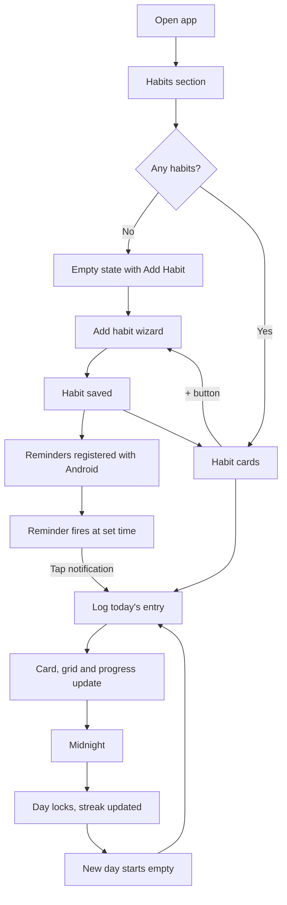

In words:

1. The app opens on the Habits section.
2. With no habits, the tab shows an empty state with an "Add Habit" button. Otherwise it shows a card per habit.
3. The + button opens the add habit wizard.
4. Saving creates the habit and registers its reminders with Android.
5. Each day the user logs the habit from its card, prompted by a reminder if one is set.
6. At midnight the day locks, the streak is updated, and a new empty day begins.

## 2. Creating a habit

The wizard has four steps (D06). The primary button is "Continue" on steps 1 to 3 and "Save Habit" on step 4. The back arrow returns to the previous step with its choices kept. The × on step 1 closes the wizard and discards everything.

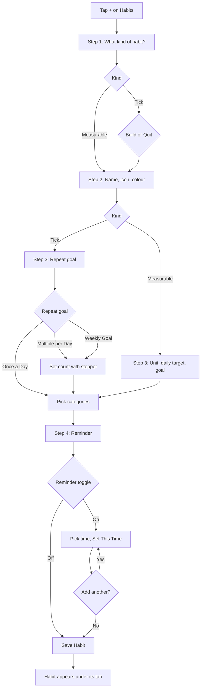

| Step | What the user sets | Rules |
| --- | --- | --- |
| 1. Kind | Tick or Measurable. For Tick: Build or Quit. | Direction applies to Tick habits only (D05). |
| 2. Name | Name, icon (glyph or emoji), colour. | Full icon set and full palette are available (D11). |
| 3. Tracking, Tick | Repeat goal: Once a Day, Multiple per Day, Weekly Goal. | The count for the last two is set with − / + only (D08). |
| 3. Tracking, Measurable | Unit, daily target, goal (Everyday or Weekly). | Target is typed (D07). |
| 3. Categories | Any number of built-in or custom categories. | Multi-select (D09). |
| 4. Reminder | Toggle, then zero or more times of day. | Minutes in 5-minute steps; each time can be removed; more can be added later from habit settings (D10). |

**What saving does**

1. Stores the habit with its kind, direction, name, icon, colour, tracking settings and categories.
2. Stores each reminder and registers it with Android's alarm scheduler (D20).
3. Returns to the Habits section. The habit appears under **Tick** or **Measure** according to its kind, and under **Weekly**. Its streak is 0 and its history is empty.

## 3. Where a habit appears

| Tab | Shows | Used for |
| --- | --- | --- |
| Measure | Measurable habits | Entering today's amount |
| Tick | Tick habits | Tapping today's result |
| Weekly | All habits | Viewing the current week, Monday to Sunday |

Category chips under the tabs narrow the list to habits in that category. A habit with several categories shows under each of them (D09).

## 4. Tracking a habit: today's state

Every habit has exactly one state for today. It starts empty each midnight and can be changed until the next midnight (D16, D19).

### 4.1 Tick, Build, once a day

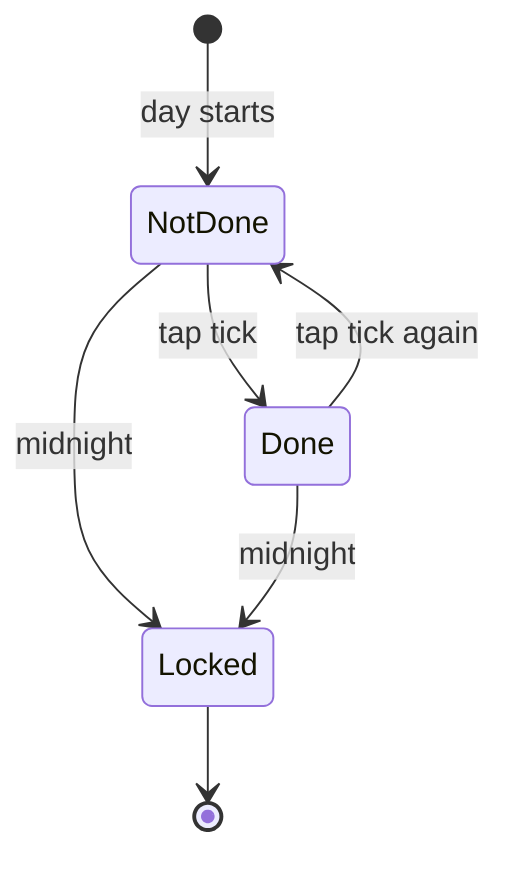

- **Not done:** tick button is grey, today's heatmap cell is outlined and empty.
- **Done:** tick button and today's cell fill with the habit's colour.
- Tapping a filled tick undoes it (D26).

### 4.2 Tick, Quit

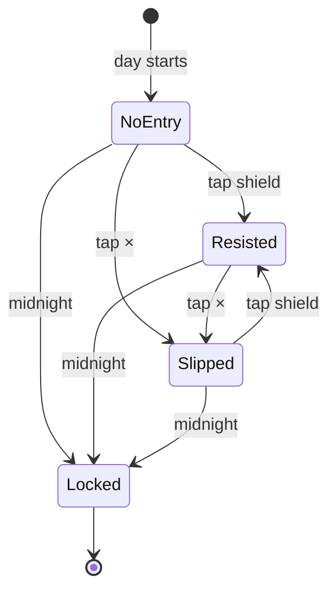

- **Resisted** is the successful outcome and counts toward the streak and the week's "resisted" total.
- **Slipped** is the unsuccessful outcome.

### 4.3 Tick, Build, weekly goal

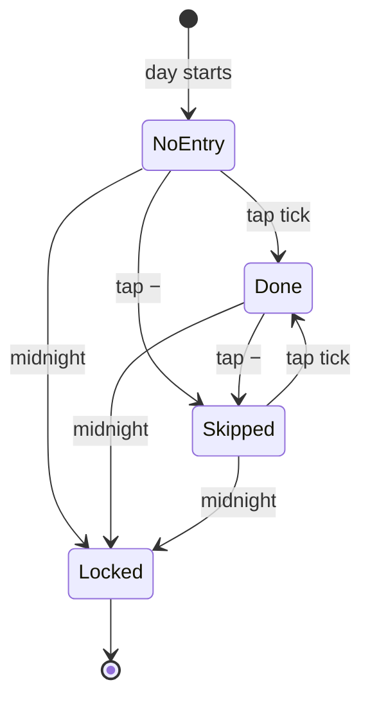

- **Done** adds one to the week's count (e.g. `1/4 this week`).
- **Skipped** records a deliberate rest day and adds nothing to the count.
- The week is judged as a whole: see [Streaks](#5-midnight-and-streaks).

### 4.4 Tick, Build, multiple per day

Today's state is a count from 0 up to the target (e.g. 0/2, 1/2, 2/2).

- Each tap of the tick button adds one, until the target is reached. The day is complete at the target. Tapping again when full clears the day (D26).

### 4.5 Measurable

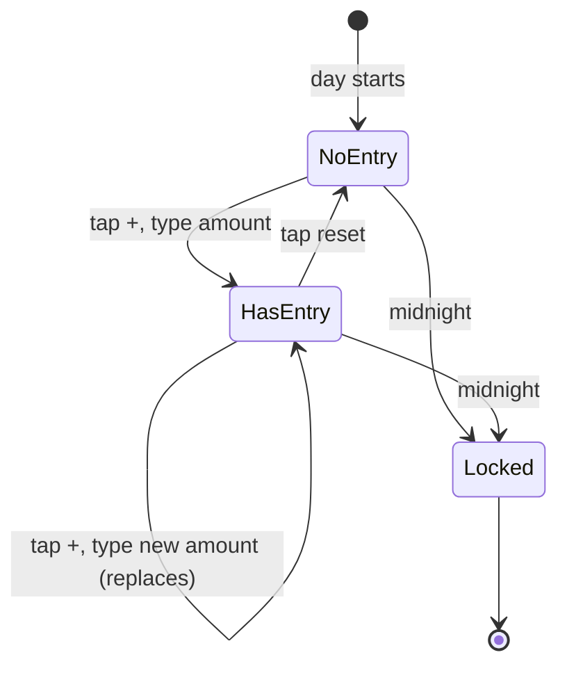

- **No entry:** the card shows `0/7 km`; today's cell shows 0.
- **Has entry:** the card shows the entry against the target (`5/7 km`); today's cell and the week's Total update and are highlighted.
- **Replace, not add.** With an entry already present, + edits it. Typing 7 after 5 gives 7, not 12 (D17).
- **Reset** removes today's entry (D15).
- An entry is below target, at target or above it. The entry is kept in every case.

### 4.6 What updates after any change

1. The card's buttons and progress text.
2. Today's cell in the history grid.
3. For measurable habits, the current week's Total.
4. The habit's row in the Weekly tab.

Past cells never change: the history grids are read-only (D16).

## 5. Midnight and streaks

At 12:00 am local time (D19):

1. **Yesterday locks.** Its state, whatever it was, is final. An empty day stays empty for good.
2. **Streaks are evaluated.**
   - **Daily habits** count streaks in days. If yesterday met the habit's goal, the streak grows by one; if not, it returns to 0.
   - **Weekly-goal habits** count streaks in weeks (D13). The streak is evaluated only when a week ends, at midnight after Sunday. If the week's count reached the goal, the streak grows by one week; if not, it returns to 0.
3. **Today starts empty** for every habit.

What "met the goal" means for each habit:

| Habit | Day or week is met when |
| --- | --- |
| Tick, Build, once a day | The day is Done |
| Tick, Build, multiple per day | The day's count reaches the target |
| Tick, Build, weekly goal | Done days in the week reach the goal |
| Tick, Quit | The day is Resisted |
| Measurable, Everyday | The day's entry reaches the daily target |
| Measurable, Weekly | The week's Total reaches the weekly target |

The week runs Monday to Sunday everywhere in the app.

## 6. Reminders

This section is about habit reminders. Task reminders work differently and are in [section 7.4](#74-task-reminders).

A reminder belongs to one habit and holds one time of day. It repeats every day (D13) and is independent of when the habit was created (D14).

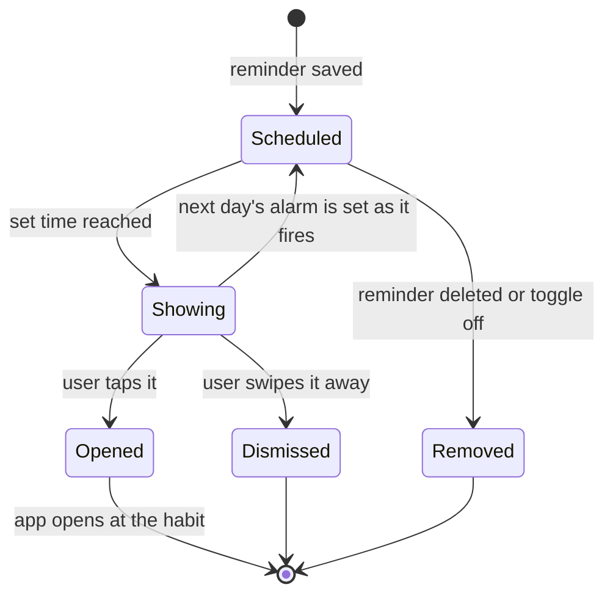

1. **Scheduled.** Saving a reminder registers an exact alarm with Android for its next occurrence (D20).
2. **Fires.** At the set minute Android wakes the app, with the app closed and with the phone offline. The app posts the notification and immediately schedules the next day's occurrence.
3. **Showing.** The notification stays until the user dismisses or opens it. It never times out (D22).
4. **Opened.** Tapping it opens the app at the habit, ready to log.
5. **Changed or removed.** Editing a time, removing a reminder, switching the toggle off or deleting the habit cancels the alarm. A changed time registers a new one.

**After a restart.** Android clears all alarms when the phone restarts. The app re-registers every reminder on boot, and again when the time zone or clock changes (D20).

**What can stop a reminder.** Notification permission denied, exact alarm permission denied, or the phone's battery optimisation putting the app to sleep. The app should detect each and tell the user how to fix it (D20).

## 7. Tasks

Tasks follow decision D29. Unlike habit entries, tasks are not locked by day: any task can be changed at any time.

### 7.1 Creating and editing a task

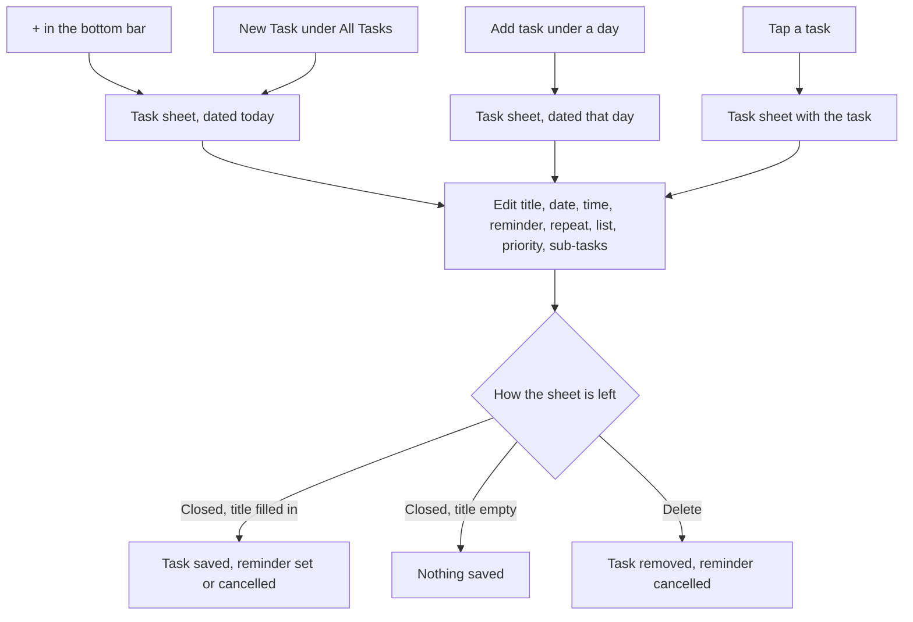

Fields depend on each other:

- A **time** needs a **date**. Picking a time on a task with no date sets the date to today.
- A **reminder** needs a **time**. Until there is one, the row reads "Set a time first".
- A **repeat** needs a **date**. Choosing a repeat on a task with no date sets the date to today.
- Clearing the **date** clears the time, the reminder and the repeat.

### 7.2 A task's state

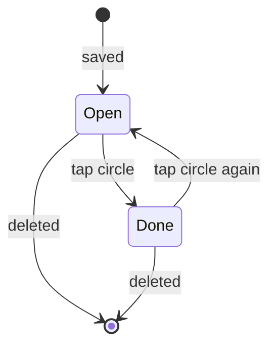

When a task becomes **Done**:

1. Its reminder, if still pending, is cancelled.
2. If it repeats and has not already produced its next occurrence, a new open task is created for the next date, with the same details and its sub-tasks unticked.

The next date is counted from the task's own date (daily: the next day; weekly: the same weekday; monthly: the same day of the month). If that date is already in the past because the task was overdue, further occurrences are skipped until the date is today or later.

### 7.3 Where a task appears

| Place | Shows |
| --- | --- |
| Timeline tab | Tasks that have a date, from every list, grouped by day with the newest day at the top. Shows the last 7 days, today and the next 365 days, newest at the top, opening at today (D37). Tasks dated outside that range appear only under All Tasks. Each day shows its open tasks, a progress count, "All done!" when nothing is open, a collapsible Completed list, and "Add task". |
| All Tasks tab | One list at a time. Open tasks grouped by priority, High first, each sorted by date. Then "New Task" and a collapsible Completed list. Tasks with no date appear only here. |
| Search | Narrows both tabs to tasks whose title contains the text. |

### 7.4 Task reminders

A task has at most one reminder, counted back from its time: at the time, or 5, 10, 15, 30 or 60 minutes before.

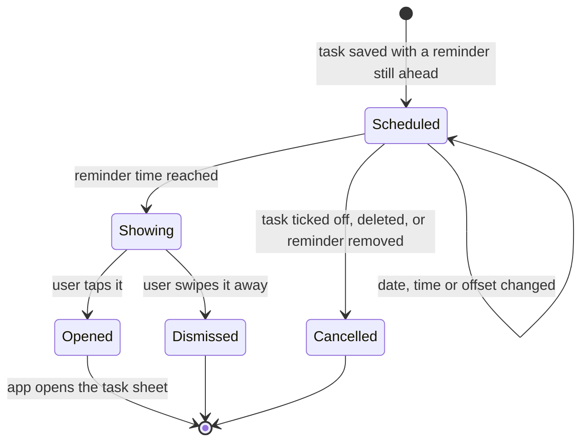

- It fires **once**, not daily. A repeating task gets a fresh reminder on each new occurrence.
- A reminder whose time has already passed is not scheduled.
- Like habit reminders, it stays until dismissed, survives a restart, and is re-registered whenever the app is opened (section 6).

## 8. Plan

The Plan shows one day as a timeline, for planning the day only (D30, D32, D35). Habits are not on it; they are tracked in the Habits section. A week strip picks the day; arrows step a day at a time, and "Today" jumps back.

### 8.1 What is on a day

| Item | Comes from | Length | Tick circle |
| --- | --- | --- | --- |
| Task | Any task with a time on that day, whether planned here or added in Tasks (D36) | Its length, or 30 minutes | Ticks the task off, in Tasks too |
| Note | "Plan this slot" with Note | As chosen | None: a note is only a record, and stays on the Plan |

### 8.2 How the timeline is laid out

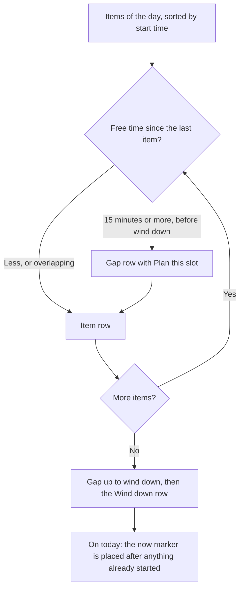

Free time is counted from the day's start to wind down (both set in Settings). Items outside that range still appear in time order; items at the same time are listed one after another.

### 8.3 Planning a slot

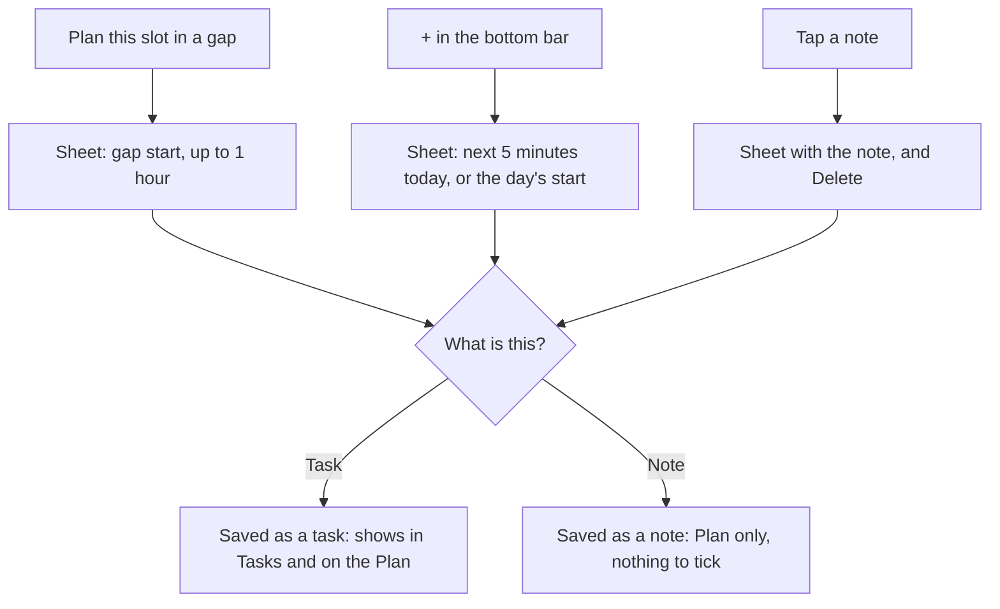

A task is saved with its day, start time, length, list and optional reminder (D36). Tapping it on the Plan later opens the full task sheet, the same as in Tasks. The Plan sheet is saved with the tick in its corner; closing it any other way discards it.

## 9. Editing a habit

"Edit habit" in a card's menu opens the wizard at the name step, filled in with the habit (D31).

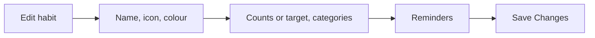

- Tick or Measurable, Build or Quit, the repeat goal, the unit and the goal period stay as they are.
- A changed target or count re-judges all past days, so the streak can change.
- Saving replaces the categories and reminders, and re-registers the reminders.

## 10. Settings and backup

| Setting | Effect |
| --- | --- |
| Day starts at | Where free time on the Plan starts. Default 7:00 AM. Must be before wind down. |
| Wind down at | Where the Wind down row sits. Default 10:00 PM. Must be after the day starts. |
| Export data | Saves everything to a JSON file (D33). |
| Import data | Replaces everything with a file's contents, after a warning (D33). |

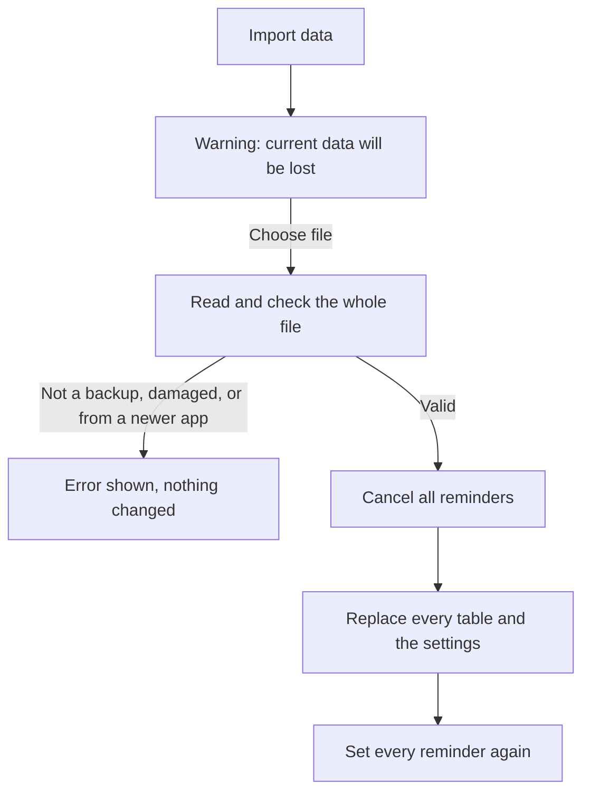

## 11. Not yet decided

Questions found while writing this flow. All are now decided: questions 1 to 7 and 9 were confirmed on 2026-11-15 (D26), and question 8 on 2026-11-17 (D31).

| # | Question | Answer | Status |
| --- | --- | --- | --- |
| 1 | Can a Tick be undone by tapping it again? | Yes, on the same day | Confirmed (D26) |
| 2 | How is a multiple-per-day habit logged? | Each tap adds one, up to the target. Tapping again when full clears the day | Confirmed (D26) |
| 3 | Does a measurable day need to reach the target to count toward the streak? | Yes | Confirmed (D26) |
| 4 | For a Measurable habit with a Weekly goal, is the typed target per day or per week? | Per week | Confirmed (D26) |
| 5 | Does a skipped day break a streak, and on which habits is skip available? | Skip exists only on weekly-goal habits, where it has no effect on the weekly count | Confirmed (D26) |
| 6 | Is the streak shown as of yesterday, or does it include today once today is met? | Includes today once met | Confirmed (D26) |
| 7 | Is a reminder skipped when the habit is already done for the day? | No, it always fires | Confirmed (D26) |
| 8 | Editing a habit after creation: what can be changed, and what happens to its history? | Name, icon, colour, categories, reminders, counts and target can change; the kind of tracking cannot. A new target re-judges past days | Confirmed (D31) |
| 9 | Does a Quit habit get a repeat goal (multiple per day, weekly)? | No. A Quit habit is always judged once a day, so the wizard skips the repeat goal for it | Confirmed (D26) |
