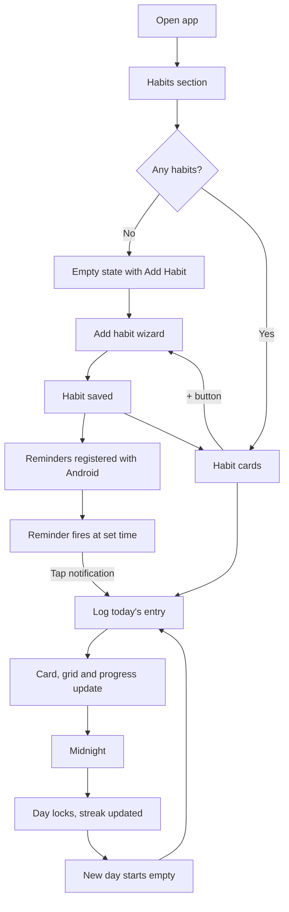
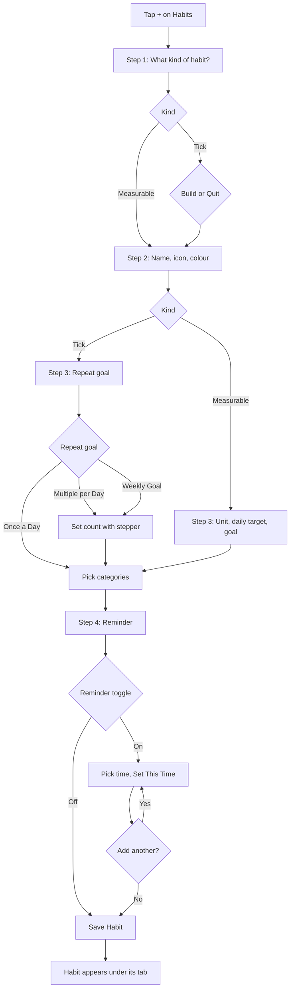
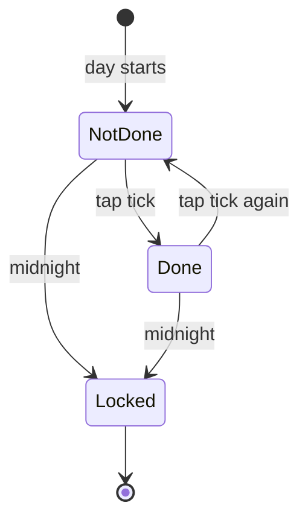
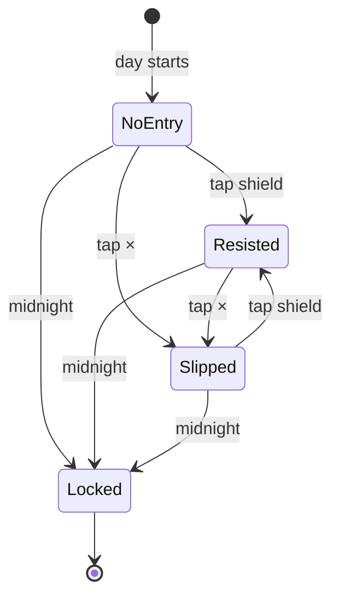
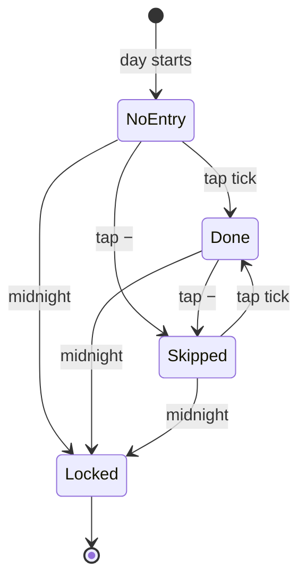
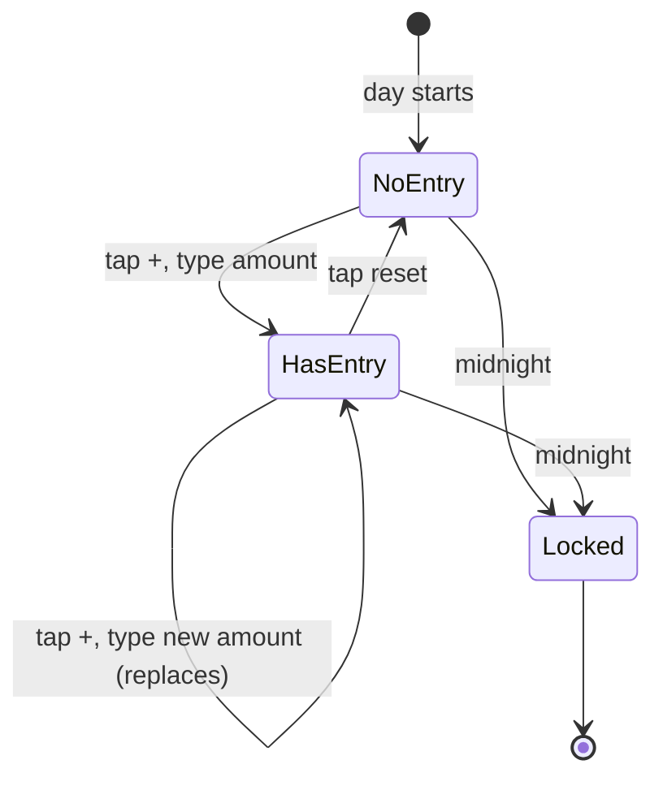
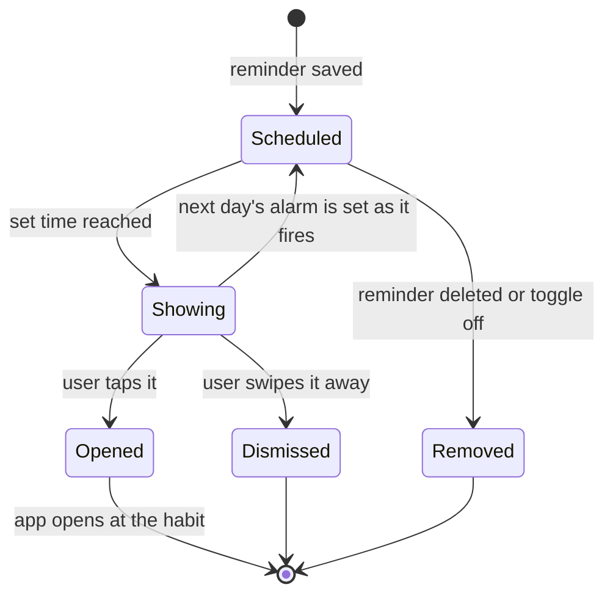

# Flow and state

How TickTracker flows, from creating a habit to tracking it day after day, and what state each thing can be in along the way. The rules here come from [decisions.md](decisions.md); decision numbers such as (D16) point to the entry that set the rule.

This file covers Habits and reminders. Plan and Tasks will be added once their flows are designed.

Where a behaviour has not been decided, it is marked **Assumed** here and listed in [Not yet decided](#7-not-yet-decided).

## 1. The whole flow at a glance

In words:

1. The app opens on the Habits section.
2. With no habits, the tab shows an empty state with an "Add Habit" button. Otherwise it shows a card per habit.
3. The + button opens the add habit wizard.
4. Saving creates the habit and registers its reminders with Android.
5. Each day the user logs the habit from its card, prompted by a reminder if one is set.
6. At midnight the day locks, the streak is updated, and a new empty day begins.

## 2. Creating a habit

The wizard has four steps (D06). The primary button is "Continue" on steps 1 to 3 and "Save Habit" on step 4. The back arrow returns to the previous step with its choices kept. The × on step 1 closes the wizard and discards everything.

| Step | What the user sets | Rules |
| --- | --- | --- |
| 1. Kind | Tick or Measurable. For Tick: Build or Quit. | Direction applies to Tick habits only (D05). |
| 2. Name | Name, icon (glyph or emoji), colour. | Full icon set and full palette are available (D11). |
| 3. Tracking, Tick | Repeat goal: Once a Day, Multiple per Day, Weekly Goal. | The count for the last two is set with − / + only (D08). |
| 3. Tracking, Measurable | Unit, daily target, goal (Everyday or Weekly). | Target is typed (D07). |
| 3. Categories | Any number of built-in or custom categories. | Multi-select (D09). |
| 4. Reminder | Toggle, then zero or more times of day. | Minutes in 5-minute steps; each time can be removed; more can be added later from habit settings (D10). |

**What saving does**

1. Stores the habit with its kind, direction, name, icon, colour, tracking settings and categories.
2. Stores each reminder and registers it with Android's alarm scheduler (D20).
3. Returns to the Habits section. The habit appears under **Tick** or **Measure** according to its kind, and under **Weekly**. Its streak is 0 and its history is empty.

## 3. Where a habit appears

| Tab | Shows | Used for |
| --- | --- | --- |
| Measure | Measurable habits | Entering today's amount |
| Tick | Tick habits | Tapping today's result |
| Weekly | All habits | Viewing the current week, Monday to Sunday |

Category chips under the tabs narrow the list to habits in that category. A habit with several categories shows under each of them (D09).

## 4. Tracking a habit: today's state

Every habit has exactly one state for today. It starts empty each midnight and can be changed until the next midnight (D16, D19).

### 4.1 Tick, Build, once a day

- **Not done:** tick button is grey, today's heatmap cell is outlined and empty.
- **Done:** tick button and today's cell fill with the habit's colour.
- **Assumed:** tapping a filled tick undoes it.

### 4.2 Tick, Quit

- **Resisted** is the successful outcome and counts toward the streak and the week's "resisted" total.
- **Slipped** is the unsuccessful outcome.

### 4.3 Tick, Build, weekly goal

- **Done** adds one to the week's count (e.g. `1/4 this week`).
- **Skipped** records a deliberate rest day and adds nothing to the count.
- The week is judged as a whole: see [Streaks](#5-midnight-and-streaks).

### 4.4 Tick, Build, multiple per day

Today's state is a count from 0 up to the target (e.g. 0/2, 1/2, 2/2).

- **Assumed:** each tap of the tick button adds one, until the target is reached. The day is complete at the target.

### 4.5 Measurable

- **No entry:** the card shows `0/7 km`; today's cell shows 0.
- **Has entry:** the card shows the entry against the target (`5/7 km`); today's cell and the week's Total update and are highlighted.
- **Replace, not add.** With an entry already present, + edits it. Typing 7 after 5 gives 7, not 12 (D17).
- **Reset** removes today's entry (D15).
- An entry is below target, at target or above it. The entry is kept in every case.

### 4.6 What updates after any change

1. The card's buttons and progress text.
2. Today's cell in the history grid.
3. For measurable habits, the current week's Total.
4. The habit's row in the Weekly tab.

Past cells never change: the history grids are read-only (D16).

## 5. Midnight and streaks

At 12:00 am local time (D19):

1. **Yesterday locks.** Its state, whatever it was, is final. An empty day stays empty for good.
2. **Streaks are evaluated.**
   - **Daily habits** count streaks in days. If yesterday met the habit's goal, the streak grows by one; if not, it returns to 0.
   - **Weekly-goal habits** count streaks in weeks (D13). The streak is evaluated only when a week ends, at midnight after Sunday. If the week's count reached the goal, the streak grows by one week; if not, it returns to 0.
3. **Today starts empty** for every habit.

What "met the goal" means for each habit:

| Habit | Day or week is met when |
| --- | --- |
| Tick, Build, once a day | The day is Done |
| Tick, Build, multiple per day | The day's count reaches the target |
| Tick, Build, weekly goal | Done days in the week reach the goal |
| Tick, Quit | The day is Resisted |
| Measurable, Everyday | **Assumed:** the day's entry reaches the daily target |
| Measurable, Weekly | **Assumed:** the week's Total reaches the weekly target |

The week runs Monday to Sunday everywhere in the app.

## 6. Reminders

A reminder belongs to one habit and holds one time of day. It repeats every day (D13) and is independent of when the habit was created (D14).

1. **Scheduled.** Saving a reminder registers an exact alarm with Android for its next occurrence (D20).
2. **Fires.** At the set minute Android wakes the app, with the app closed and with the phone offline. The app posts the notification and immediately schedules the next day's occurrence.
3. **Showing.** The notification stays until the user dismisses or opens it. It never times out (D22).
4. **Opened.** Tapping it opens the app at the habit, ready to log.
5. **Changed or removed.** Editing a time, removing a reminder, switching the toggle off or deleting the habit cancels the alarm. A changed time registers a new one.

**After a restart.** Android clears all alarms when the phone restarts. The app re-registers every reminder on boot, and again when the time zone or clock changes (D20).

**What can stop a reminder.** Notification permission denied, exact alarm permission denied, or the phone's battery optimisation putting the app to sleep. The app should detect each and tell the user how to fix it (D20).

## 7. Not yet decided

Gaps found while writing this flow. Sections above marked **Assumed** depend on these.

| # | Question | Assumed for now |
| --- | --- | --- |
| 1 | Can a Tick be undone by tapping it again? | Yes, on the same day |
| 2 | How is a multiple-per-day habit logged? | Each tap adds one, up to the target |
| 3 | Does a measurable day need to reach the target to count toward the streak? | Yes |
| 4 | For a Measurable habit with a Weekly goal, is the typed target per day or per week? | Per week |
| 5 | Does a skipped day break a streak, and on which habits is skip available? | Skip exists only on weekly-goal habits, where it has no effect on the weekly count |
| 6 | Is the streak shown as of yesterday, or does it include today once today is met? | Includes today once met |
| 7 | Is a reminder skipped when the habit is already done for the day? | No, it always fires |
| 8 | Editing and deleting a habit from the overflow menu: what can be changed after creation, and what happens to its history? | Not assumed |
